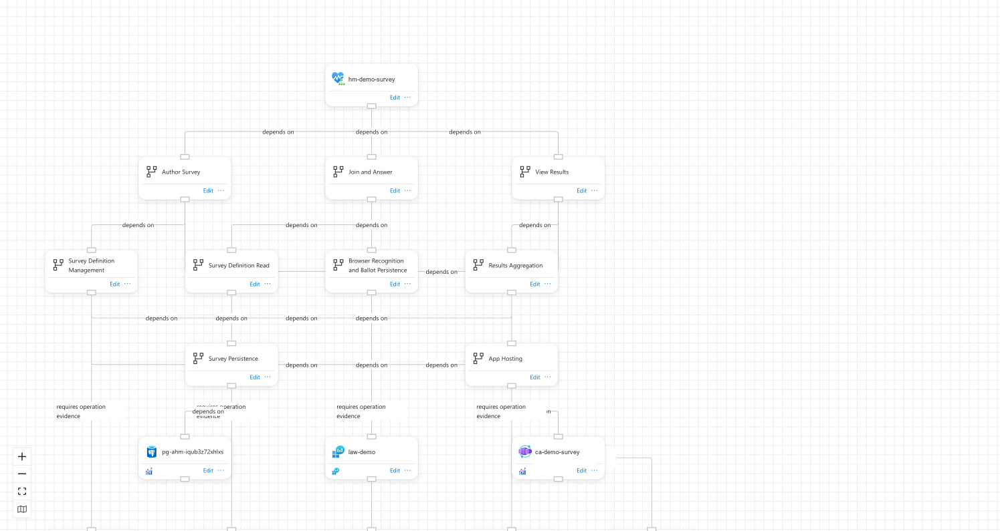
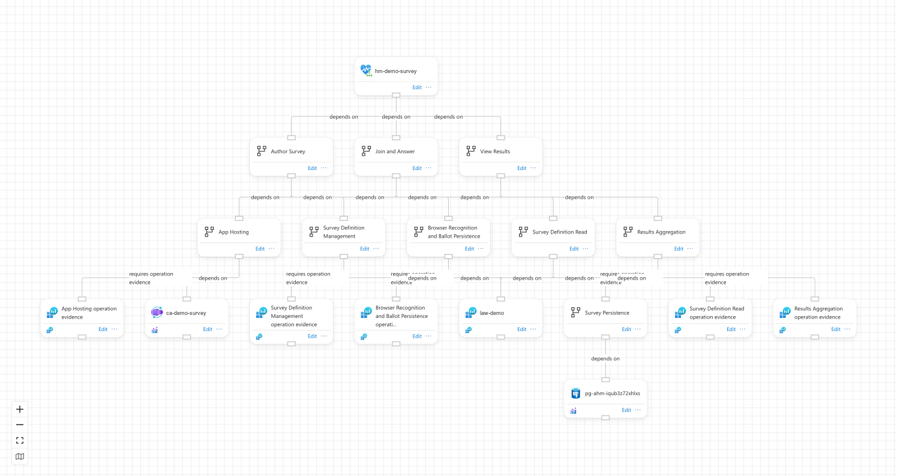
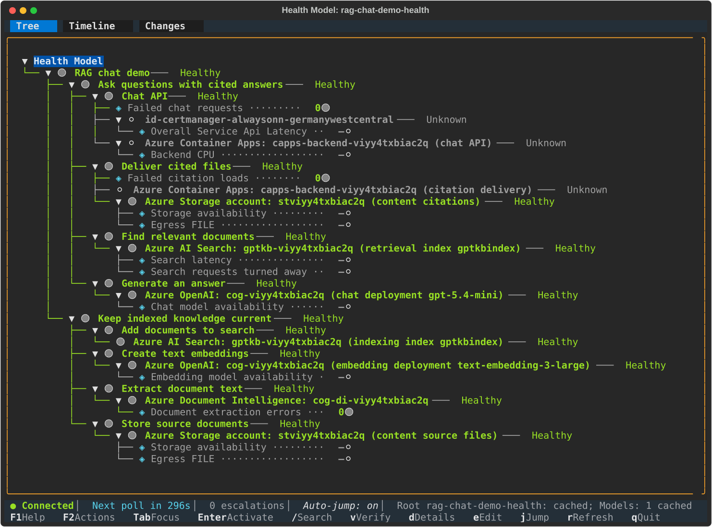
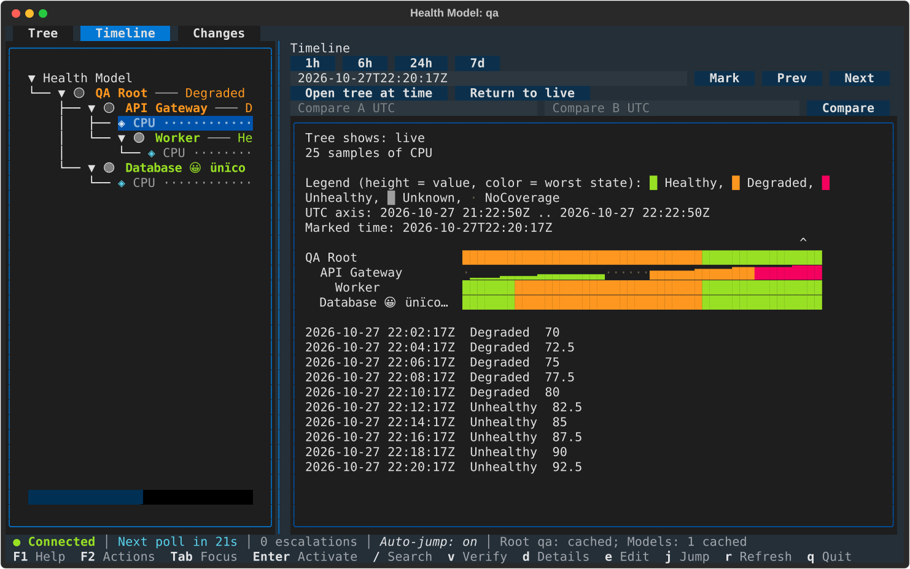
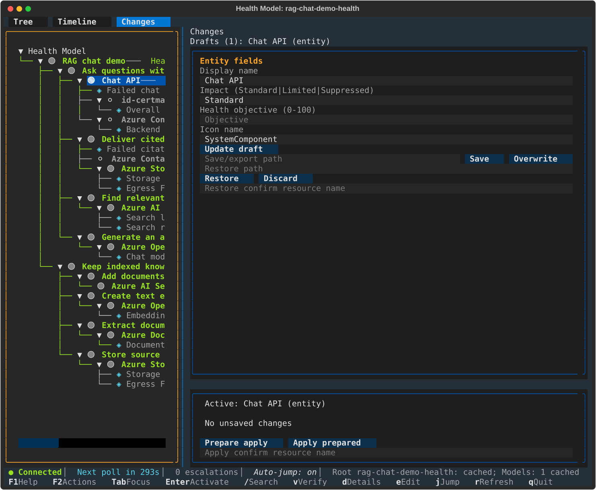

# healthmodels-plus

[](https://github.com/abossard/healthmodels-plus/actions/workflows/ci.yml)
[](https://github.com/abossard/healthmodels-plus/releases/latest)
[](src/healthmodels-plus/pyproject.toml)
[](https://learn.microsoft.com/cli/azure/install-azure-cli)
[](#requirements)
[](https://github.com/astral-sh/uv)
[](https://textual.textualize.io)

A collection of tools for [Azure Monitor health models](https://learn.microsoft.com/azure/azure-monitor/health-models/overview).

For now it holds one Azure CLI extension, `healthmodels-plus` (preview), with two commands:

- `az monitor health-models layout arrange|export|import` arranges the entities of a health model on its canvas, like **Arrange** in the portal designer, and backs up and restores canvas layouts.
- `az monitor health-models tui` browses health models, watches their health live, looks back in time and makes guarded edits in a terminal UI.

<p align="center">
  
  
  <br>
  <em>The canvas before and after <code>az monitor health-models layout arrange</code></em>
</p>

<p align="center">
  
  <br>
  <em><code>az monitor health-models tui</code> watching a degraded model</em>
</p>

## Requirements

- Azure CLI 2.75.0 or newer.
- `az login` for the subscription that holds your health models.
- The official `health-models` extension is optional. Neither command needs it. With both installed, `az monitor health-models --help` lists the official commands next to `layout` and `tui`.

## Install

The extension is not in the Azure CLI extension index. Install the wheel of a [release](https://github.com/abossard/healthmodels-plus/releases):

```bash
VERSION=0.2.0
az extension add --yes --source "https://github.com/abossard/healthmodels-plus/releases/download/v$VERSION/healthmodels_plus-$VERSION-py3-none-any.whl"
```

`--yes` skips the prompt for an extension from outside the index. The first install takes a few minutes, since it also installs the extension's Python packages.

To get the latest release instead (needs `curl` and `jq`):

```bash
WHEEL_URL="$(curl -fsSL https://api.github.com/repos/abossard/healthmodels-plus/releases/latest | jq -r '.assets[] | select(.name | endswith(".whl")) | .browser_download_url')"
az extension add --yes --source "$WHEEL_URL"
```

## Upgrade

Set `WHEEL_URL` to the newer wheel as in [Install](#install) and add it with `--upgrade`. Without `--upgrade` the installed version stays.

```bash
az extension add --upgrade --yes --source "$WHEEL_URL"
```

## Uninstall

```bash
az extension remove --name healthmodels-plus
```

### `layout` or `tui` is "misspelled or not recognized" right after install

Azure CLI 2.91 sometimes reports commands under `az monitor health-models` as not recognized, right after an extension is installed or while other `az` commands run at the same time. It happens to the official `health-models` extension too, and a later call works again. `az extension show --name healthmodels-plus` confirms the extension is installed.

## Usage

Layout engines, keys and the edit flow in detail: [src/healthmodels-plus/README.md](src/healthmodels-plus/README.md).

### Canvas layout

```bash
az monitor health-models layout export -g MyResourceGroup -n MyHealthModel -o json > layout.json
az monitor health-models layout arrange -g MyResourceGroup -n MyHealthModel --dry-run
az monitor health-models layout arrange -g MyResourceGroup -n MyHealthModel
az monitor health-models layout import -g MyResourceGroup -n MyHealthModel --layout layout.json
```

`--dry-run` returns the new positions without saving them:

```console
$ az monitor health-models layout arrange -g MyResourceGroup -n Connectivity --dry-run -o table
Name                                   X     Y
-------------------------------------  ----  ---
application-delivery                   0     192
discover-application-delivery-storage  0     384
discover-dns-storage                   250   384
...
security-services                      1000  192
```

`--verbose` logs why the engine chose a layout (trimmed, the Azure CLI's request log omitted):

```console
$ az monitor health-models layout arrange -g MyResourceGroup -n Connectivity --dry-run --verbose -o none
INFO: Loaded 11 entities (11 with a canvas position) and 10 relationships
INFO: Arranging 11 entities and 10 relationships with engine 'auto' as 1 part(s)
INFO: Auto: layered has 0 edges through cards, 0 false links, 0 crossings, 0 label clashes, score -19
INFO: Auto: tree has 0 edges through cards, 0 false links, 0 crossings, 0 label clashes, score -19
INFO: Auto: keeping layered, the first of equal scores
INFO: 10 of 11 positions change; dry run, nothing is saved
```

`--engine` picks a layout instead of `auto`. `keep-order` keeps the left-to-right order you drew:

```console
$ az monitor health-models layout arrange -g MyResourceGroup -n Connectivity --engine keep-order --dry-run --verbose -o none
INFO: Keep-order: 11 cards keep their drawn left-to-right order, 0 without a position go beside their placed neighbours or last in their row
INFO: 10 of 11 positions change; dry run, nothing is saved
```

`--entity-name` arranges one entity and everything below it. The entity keeps its position:

```console
$ az monitor health-models layout arrange -g MyResourceGroup -n Connectivity --entity-name routing --dry-run -o table
Name                      X      Y
------------------------  -----  -----
discover-routing-storage  250.0  385.0
```

`export` writes every position as a list of `{"name", "x", "y"}`. `import` writes them back; `--dry-run` lists the positions that would change.

```console
$ az monitor health-models layout export -g MyResourceGroup -n Connectivity -o json > layout.json
$ jq -c '.[0:2]' layout.json
[{"name":"application-delivery","x":1000.0,"y":193.0},{"name":"connectivity","x":500.0,"y":0.0}]
$ az monitor health-models layout import -g MyResourceGroup -n Connectivity --layout layout.json --dry-run -o table
```

### Terminal UI

| Timeline | Changes |
|---|---|
|  |  |

```bash
az monitor health-models tui                              # pick a model from the active subscription
az monitor health-models tui -g myRg                      # pick a model from one resource group
az monitor health-models tui -g myRg --model myModel      # open a model directly
az monitor health-models tui -g myRg --model myModel --plain --poll-interval 10
```

Without a TTY, or with `--plain`, it prints the tree as text and polls until `Ctrl+C`:

```console
$ az monitor health-models tui -g MyResourceGroup --model Connectivity --plain
Health Model: Connectivity — Poll interval: 30s
━━━━━━━━━━━━━━━━━━━━━━━━━━━━━━━━━━━━━━━━━━━━━━━━━━━━━━━━━━━━━━━━━━━━━━
└── ⚪ connectivity ─── Unknown
    ├── ⚪ Application Delivery ─── Unknown
    │   └── ⚪ Application Delivery storage discovery ─── Unknown
    ├── ⚪ DNS ─── Unknown
    │   └── ⚪ DNS storage discovery ─── Unknown
    ...
Next poll in 30s…  (Ctrl+C to quit)
```

## Development

Needs [`uv`](https://docs.astral.sh/uv/getting-started/installation/) and the Azure CLI. From `src/healthmodels-plus`:

```bash
uv sync --locked
uv run --locked python -m pytest
rm -rf dist && uv build --wheel
```

The tests rewrite ten screenshot SVGs under `azext_healthmodels_plus/tui/tests/`. Restore them before committing with `git checkout -- 'azext_healthmodels_plus/tui/tests/*.svg'`.

Install the build into an isolated extension directory, so your regular extensions stay untouched. Run the commands in the same shell.

```bash
AZURE_EXTENSION_DIR="$(mktemp -d)"
export AZURE_EXTENSION_DIR
az extension add --yes --source dist/healthmodels_plus-*.whl
az monitor health-models layout --help
az monitor health-models tui --help
```

[CI](.github/workflows/ci.yml) runs the tests on Python 3.11 to 3.13, builds the wheel, installs it into the Azure CLI, runs the help commands and removes it.

## Release

1. In `src/healthmodels-plus`, bump the version with `uv version 0.2.0` (updates `pyproject.toml` and `uv.lock`) and add an entry to `HISTORY.rst`. Merge that to `main`.
2. Tag the merge commit on `main` and push the tag:

   ```bash
   git tag v0.2.0
   git push origin v0.2.0
   ```

The [Release workflow](.github/workflows/release.yml) fails if the tag is not `v` plus the package version. It runs CI, creates the GitHub Release with the wheel and generated notes, then installs the extension from the release URL, runs the help commands and removes it.
