# Arrange showcase

What `az monitor health-models layout arrange|export|import` does to a real health model, shown in the Azure portal's Designer and Graph views.

- Four health models in `rg-anbotrai`: `anbotrai-platform`, `-experience`, `-capacity` and `-stability`. All four have the same tree: the model root, `plan-trip`, six services and their resources (17 entities, 16 relationships).
- Only the root had a canvas position, so the portal stacked all other cards in one column. That layout is saved in [layouts/](layouts/) as `<model>.mangled.json`, and every run below ends by restoring it, checked by an export diff.
- Features that need another topology use temporary `demo-*` relationships or entities on `anbotrai-stability`, removed again afterwards (names checked against a snapshot).
- Every step is scripted: [RUNBOOK.md](RUNBOOK.md) and [scripts/showcase.sh](scripts/showcase.sh). Each feature folder holds its `prepare.json` (layout import) and, for topology changes, `topology.sh add|remove`.
- Recorded with healthmodels-plus 0.2.0, except the off-row part of the subtree section, which uses 0.4.0. 0.4.0 fixes the first three [findings](#findings), so some 0.4.0 layouts, decision logs and scores differ from what is shown here.

## Baseline: portal Arrange vs the CLI

| | Designer | Graph |
|---|---|---|
| Mangled (as found) | 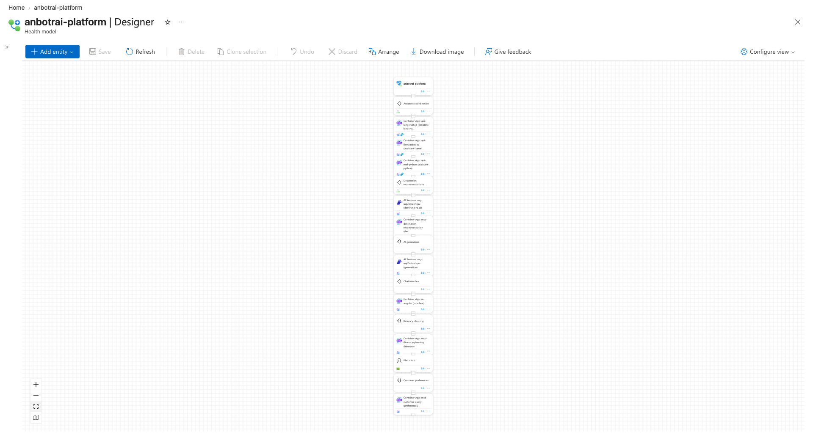 | 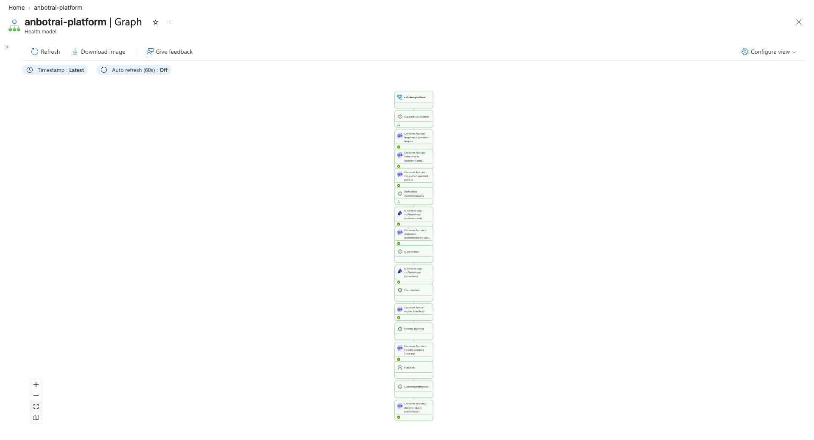 |
| Portal **Arrange**, then Save | 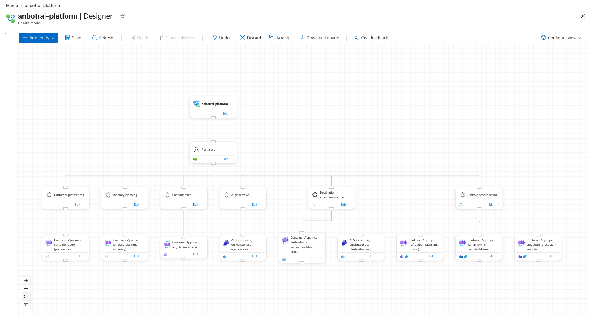 | 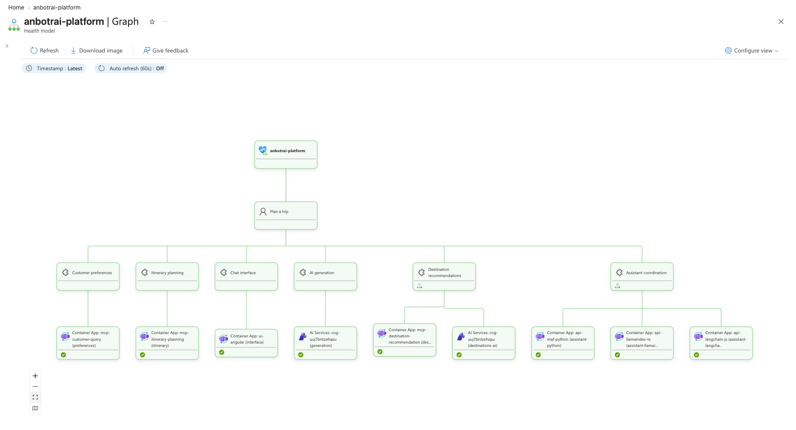 |
| `layout arrange` (`auto`) | 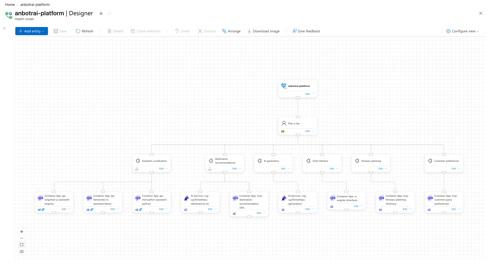 | 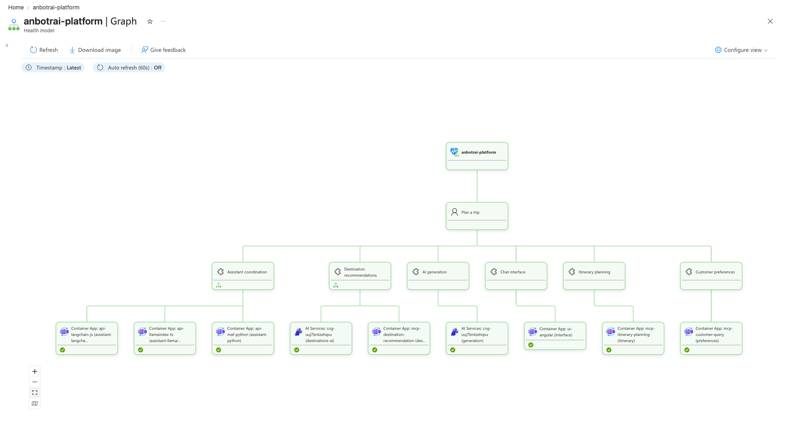 |

- Portal Arrange only moves cards in the open designer; nothing is stored until Save. `layout arrange` saves directly, and `--dry-run` previews.
- Portal Arrange vs `auto`, the same on all four models:
  - Rows: portal pitch 193 px with a ragged last row (y 579, 589, 597 by card height); `auto` 192 px with one y per row.
  - Root: portal x 625; `auto` centres root and `plan-trip` over the six services (x 1250).
  - Order: the portal mirrors it (`preferences` first); `auto` uses entity order (`assistant` first).
  - Both draw 0 edges through cards, 0 false links, 0 crossings.
- On a plain tree all five engines give byte-identical positions (checked on all four models). `auto` logs a tie and keeps `layered`:

  ```text
  INFO: Auto: layered has 0 edges through cards, 0 false links, 0 crossings, 0 label clashes, score 6
  INFO: Auto: tree has 0 edges through cards, 0 false links, 0 crossings, 0 label clashes, score 6
  INFO: Auto: keeping layered, the first of equal scores
  ```

- Every engine, every model, designer and graph: [baseline/](baseline/) (`05-layered`, `06-tree`, `07-network`, `08-keep-order`; `03-restored` shows the restore). Per-model facts in each `NOTES.md`.

The engines only differ once the canvas or the topology gives them something to decide. The features below set that up.

## Features

Each feature ran in its own session, which designed the setup, checked it offline against the engine (`layout.py`), then ran it live. Each one was graded on whether the screenshots show the feature, not only the logs; four were sent back for a refinement.

| Feature | Model | Setup | Grade |
|---|---|---|---|
| [Straight columns](#straight-columns) | platform | positions | kept, with an engine caveat |
| [Keep-order](#keep-order) | platform | positions | kept |
| [No lines through cards](#no-lines-through-cards) | capacity | positions | kept |
| [Arrange one subtree](#arrange-one-subtree---entity-name) | capacity | positions | kept |
| [Cards without a position](#cards-without-a-position) | experience | positions | refined |
| [Backup, restore, minimal saves](#backup-restore-minimal-saves) | experience | positions | kept |
| [Cards with several parents](#cards-with-several-parents) | stability | 1 or 2 demo relationships (two variants) | refined |
| [Long edges](#long-edges) | stability | 1 demo relationship | refined |
| [Row order with few crossings](#row-order-with-few-crossings) | stability | 3 demo relationships | refined |
| [Network engine](#network-engine) | stability | 5 demo relationships | kept |
| [Shelves for unconnected parts](#shelves-for-unconnected-parts) | stability | 7 demo entities | kept |
| [Relationship labels](#relationship-labels) | stability | 2 labelled demo relationships | kept |

### Straight columns

A parent with one child sits straight above it (`straighten`); a parent with several is centred over them on the half-column grid (`place`). Details: [features/straight-columns](features/straight-columns/README.md).

| Prepared: 8 parents off their columns | Arranged |
|---|---|
| 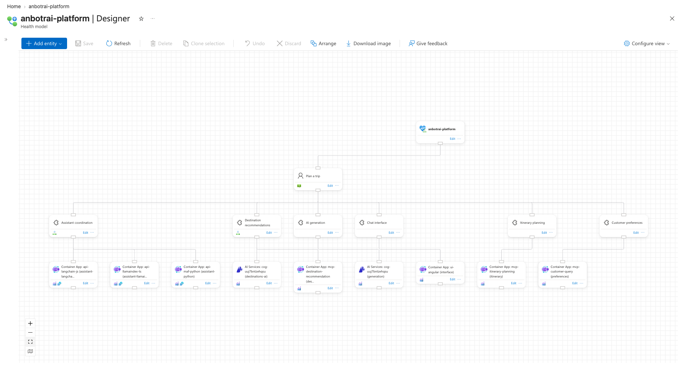 | 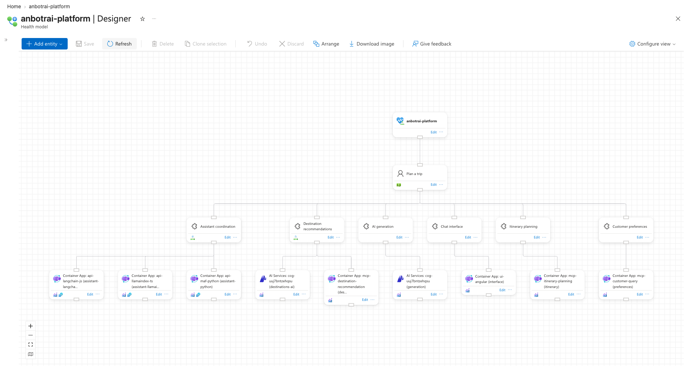 |

- 8 false links and zig-zag lines become a clean tree: `8 of 17 positions change`, only the parents move.
- Root over `plan-trip`, `plan-trip` over six services and `destinations` over two resources end exactly centred.
- Caveat: `generation`, `interface` and `itinerary` stay half a column off their only child (see [Findings](#findings)).

### Keep-order

`--engine keep-order` tidies spacing, rows and centring, and keeps every row's drawn left-to-right order. Details: [features/keep-order](features/keep-order/README.md).

| Prepared: user-journey order, messy | `keep-order` | `layered` from the same canvas |
|---|---|---|
| 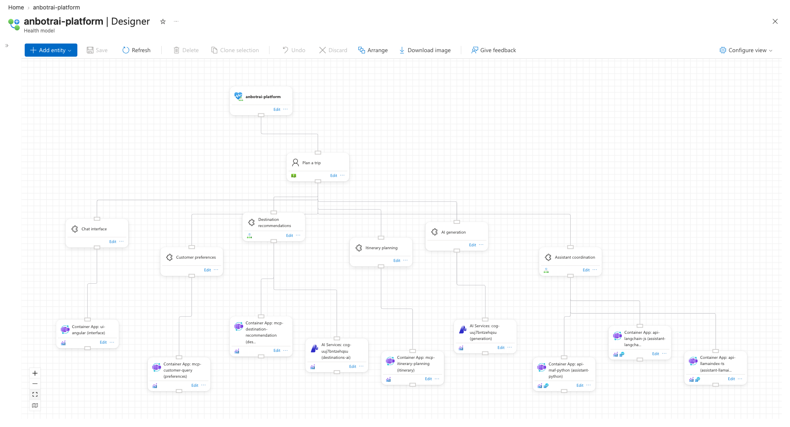 | 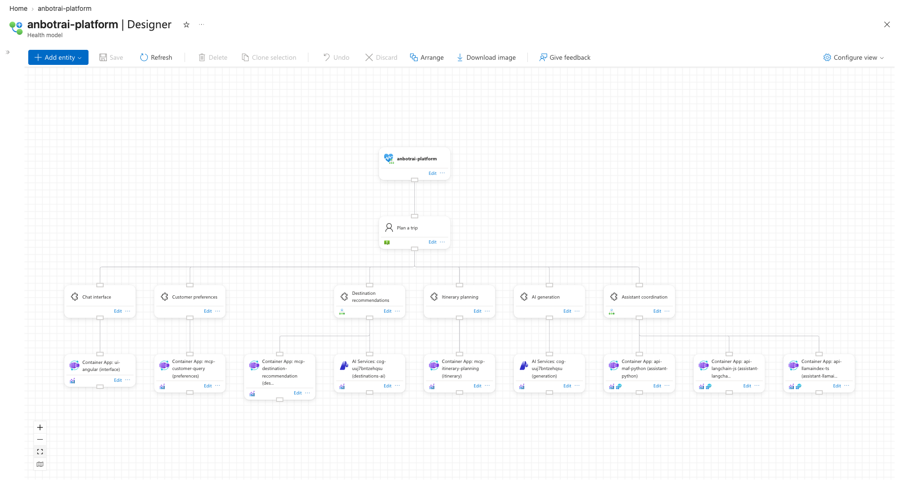 |  |

- Service row stays `interface, preferences, destinations, itinerary, generation, assistant` with keep-order; `layered` falls back to `assistant, destinations, generation, ...`.
- Both results score the same (2200 x 706 px, 0 faults), so keep-order costs nothing on this model.

### No lines through cards

The engines score a drawing the way the portal renders it: step lines down, across at half height, down. A line through a card costs most. Details: [features/through-cards](features/through-cards/README.md).

| Prepared: looks tidy, but three services seem to hang under other services | Arranged |
|---|---|
| 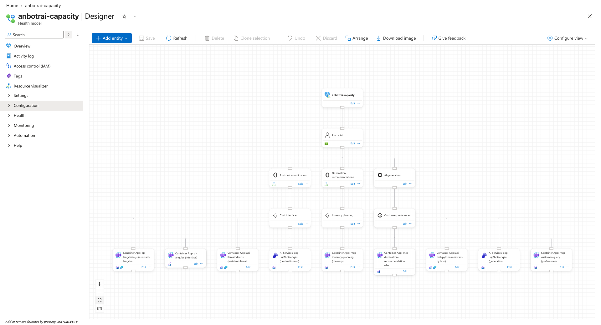 | 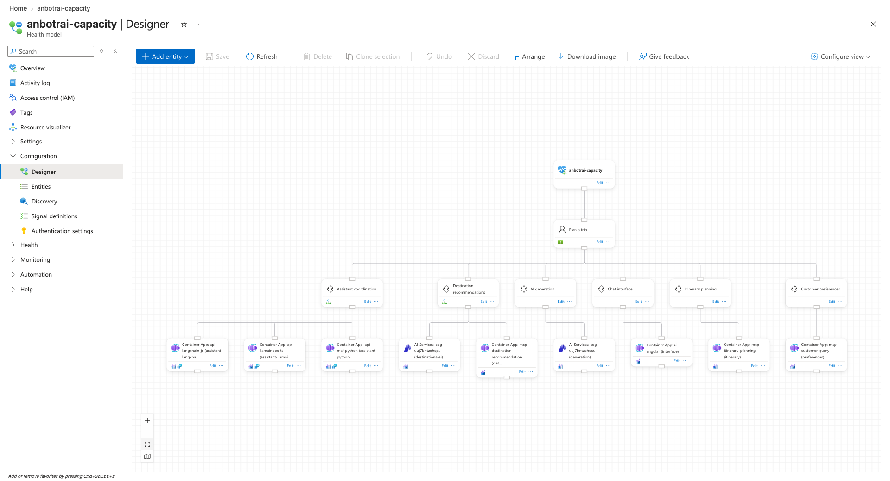 |

- `describe()`: prepared 15 edges through cards, 12 false links, 3 crossings; arranged 0, 0, 0.
- `Chat interface` reads as a child of `Assistant coordination` before, because `plan-trip -> interface` runs behind that card.

### Arrange one subtree (`--entity-name`)

`--entity-name assistant` tidies only `assistant` and the entities below it; `assistant` keeps its position and the cards beside it in those rows slide aside. Details: [features/entity-subtree](features/entity-subtree/README.md).

| Prepared: tidy, except a scrambled `assistant` subtree | After `--entity-name assistant` |
|---|---|
|  |  |

```text
INFO: 'assistant' stays at (750, 384); 6 cards beside it slid 250 px right, 5 slid 250 px left to clear the subtree
```

- The root and `plan-trip` don't move; `--dry-run` listed every move before saving, and it matched the offline result.

Cards just outside the subtree's rows: in the second canvas `interface-resource` and `generation-resource` sit inside the subtree's rows, with `itinerary-resource` and `destinations-mcp-resource` just below them. The old code slid the first two onto the other two. The new code takes the other two along.

| Prepared: off-row cards, `assistant` at (750.4, 384.6) | Old code (its offline result, imported): 2 overlaps | New code, live `--entity-name assistant` |
|---|---|---|
|  |  |  |

```text
INFO: 'assistant' stays at (750.4, 384.6); 6 cards beside it slid 375 px right, 5 slid 250 px left to clear the subtree
INFO: 14 of 15 positions change; saving them
```

### Cards without a position

`keep-order` places cards without a position (new entities, or positions cleared by importing `null`) beside their placed neighbours and moves nothing else. Details: [features/unplaced-cards](features/unplaced-cards/README.md).

| Prepared: 3 resource positions cleared, the portal piles them on the left | `keep-order` |
|---|---|
| 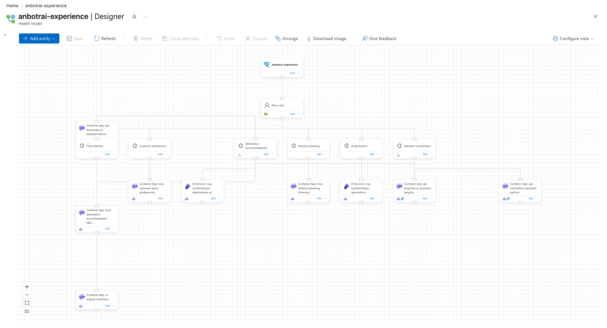 | 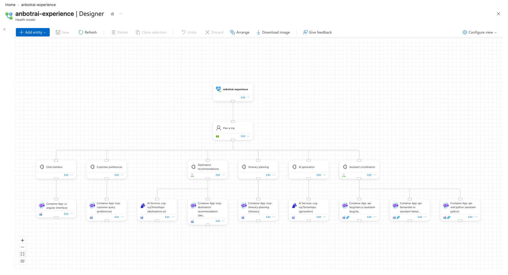 |

```text
INFO: Keep-order: 14 cards keep their drawn left-to-right order, 3 without a position go beside their placed neighbours or last in their row
INFO: Part 1 of 1 is 2200 x 706 px with 0 edges through cards, 0 false links, 0 crossings, 0 label clashes
INFO: 3 of 17 positions change; saving them
```

- The three cards land exactly where they were before their positions were cleared, including the middle one of the assistant's three resources.

### Backup, restore, minimal saves

`export` is a full backup (null for unplaced cards), dry runs preview, `import` restores exactly, and only cards that move are saved. Details with full CLI transcripts: [features/backup-restore](features/backup-restore/README.md).

| Hand-made layout, exported as backup | After `arrange` | After `import` of the backup |
|---|---|---|
|  |  |  |

- `arrange --dry-run` left the model untouched (export diff); a second `arrange` and a second `import` both report `0 of 17 positions change`.
- A stale file: unknown names are skipped with a warning, `null` clears a position.

### Cards with several parents

`tree` hangs a card with several parents under the deepest ancestor they share and keeps each subtree in its own columns; `layered` moves cards so lines stay short; `auto` draws both, scores them and keeps the better. Two variants show `auto` keeping each engine once. Details: [features/shared-children](features/shared-children/README.md).

**a.** `assistant` also watches the itinerary MCP server. `auto` keeps `layered`.

| `tree`: itinerary stays 5th, the assistant's line runs past three unrelated resources | `layered` (= `auto`): the itinerary subtree moves next to the assistant |
|---|---|
|  |  |

```text
INFO: Auto: layered has 0 edges through cards, 3 false links, 0 crossings, 0 label clashes, score 37
INFO: Auto: tree has 0 edges through cards, 31 false links, 0 crossings, 0 label clashes, score 322
INFO: Auto: keeping layered, the lower score
```

**b.** The LangChain assistant uses AI generation, and the destinations MCP server calls the generation model. `auto` keeps `tree`.

| `tree` (= `auto`): `AI generation` hangs between its two parents | `layered`: `AI generation` pushed far left |
|---|---|
|  |  |

```text
INFO: Auto: layered has 0 edges through cards, 12 false links, 0 crossings, 0 label clashes, score 129
INFO: Auto: tree has 0 edges through cards, 3 false links, 0 crossings, 0 label clashes, score 35
INFO: Auto: keeping tree, the lower score
```

### Long edges

A relationship that skips a row gets dummy points that follow the portal's routing; the point in the middle row reserves the line's horizontal run, so cards move off the line. Details: [features/long-edges](features/long-edges/README.md).

| Prepared: root -> `preferences` runs behind `Plan a trip` and reads as `plan-trip -> preferences` | Arranged: the root moves half a column, the line has its own lane |
|---|---|
| 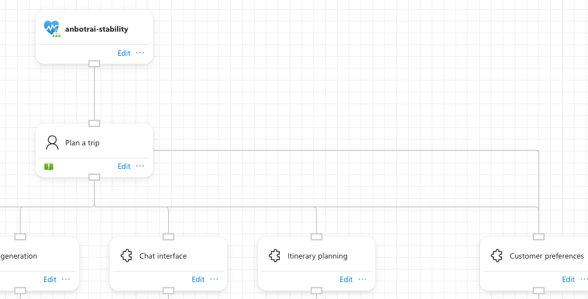 | 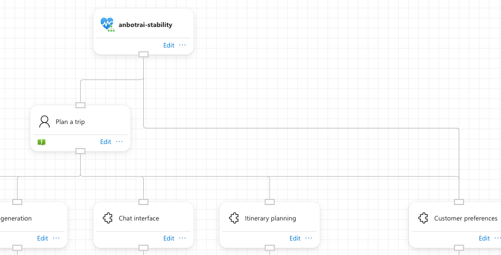 |

Full canvases: [prepared](features/long-edges/01-prepared-designer.png), [arranged](features/long-edges/02-arranged-designer.png).

```text
INFO: 4 rows by longest path; 1 edges skip rows and get 1 extra points
INFO: 1 of 17 positions change; saving them
```

### Row order with few crossings

Rows are ordered by barycenter sweeps and neighbour swaps, then refined by a local search on the portal drawing. Three demo cross-links (assistant and itinerary use the generation model, destinations reads customer preferences) were picked by an offline search for the biggest visible difference. Details: [features/crossings](features/crossings/README.md).

| Prepared, naive input order: one bar across the whole resource row | Arranged with `layered`: three separate line groups |
|---|---|
|  |  |

```text
INFO: Row order: 6 crossings to start with, 0 at best (after 3 of 12 sweeps)
INFO: Part 1 of 1 is 2200 x 706 px with 0 edges through cards, 10 false links, 0 crossings, 0 label clashes
```

- Saved layouts: false links 42 -> 10, horizontal line length 7500 -> 4500 px, `cost` 443 -> 108.

### Network engine

The portal draws every line between two rows at the same height, so lines of different parents merge and suggest links that don't exist. `--engine network` gives each child that would join an unrelated line its own height. Details: [features/network](features/network/README.md).

| `layered`: one merged line, 27 false links | `network`: own heights, 0 false links |
|---|---|
| 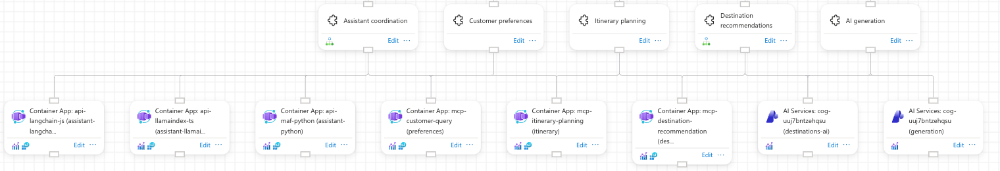 | 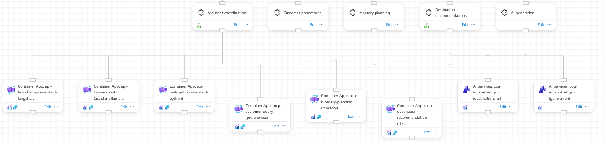 |

```text
INFO: Network: own heights for lines that would merge took the canvas height from 706 to 834 px
```

- Cost: 128 px height and 1 crossing. Full canvases: [layered](features/network/01-layered-designer.png), [network](features/network/02-network-designer.png).

### Shelves for unconnected parts

Unconnected parts are laid out one by one, largest first, and shelved left to right; a part opens a new shelf below when that fits a 16:9 screen better. Details: [features/shelves](features/shelves/README.md).

| Prepared: 24 cards stacked | Arranged: tree on shelf 1, four demo parts on shelf 2 |
|---|---|
|  |  |

```text
INFO: Arranging 24 entities and 19 relationships with engine 'auto' as 5 part(s)
INFO: Part 2 opens a new shelf below the others: that fits a 16:9 screen better
INFO: Part 3 goes beside the previous one on the current shelf
```

### Relationship labels

The portal writes a relationship's `displayName` in the middle of its line. The engines count labels drawn on top of each other and prefer drawings without. Details: [features/labels](features/labels/README.md).

| Prepared: `sends drafts to` hidden under `renders results of` | Arranged: both readable |
|---|---|
| 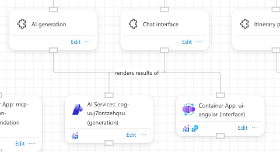 | 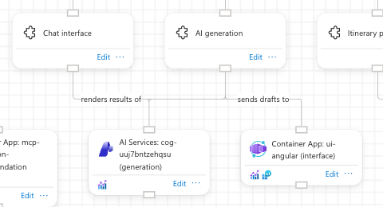 |

```text
INFO: Local search kept 1 of 26 swaps (limit 300), score 18 -> 8 (lower is better)
INFO: 2 of 17 positions change; saving them
```

- The 10 points are exactly one label clash; only the two service cards swap.

## Findings

Weak spots of the engine that the showcases ran into, each reproducible offline with `layout.py`. 0.4.0 fixes the first three:

- **Single-child columns stay half a column off.** `straighten` makes one left-to-right pass and only moves a card when its neighbour's gap already fits. The service row is packed tighter than the resources, so on these models only `preferences` gets straight; `generation`, `interface` and `itinerary` keep a half-column jog. A right-to-left pass straightens all four, still with 0 faults ([straight-columns](features/straight-columns/README.md)). Fixed in 0.4.0: each row is visited both ways.
- **Scores are taken before snapping.** The local search and `auto` score unsnapped positions; `normalize` then snaps to the 125 px grid. With an earlier crossings setup that took the score from 186 back to 425 and the false links from 17 back to 41 ([crossings](features/crossings/README.md)). In shared-children variant a, `auto` logs layered at 3 false links, the saved layout has 11, and a first variant b had `auto` keep the engine that is worse after snapping ([shared-children](features/shared-children/README.md)). Fixed in 0.4.0: drawings are scored after snapping, and a second local search moves a card up to three places, so it gets past a card in the way. Variant a now saves 3 false links (was 11). In variant b, `layered` and `tree` both reach 3 false links, so `auto` keeps the first, `layered`.
- **A new card can land in the wrong group with `keep-order`.** An unplaced card gets its parent's x; on a tie with a placed card of another group, the entity name decides. With a packed row, `interface-resource` lands between the assistant's resources (12 false links) ([unplaced-cards](features/unplaced-cards/README.md)). Fixed in 0.4.0: on a tie, the parents' order on the canvas decides.
- Shelf decisions for one-card parts are logged at debug level only (`--debug`), by design.
