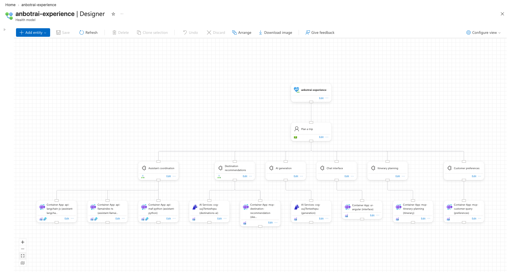
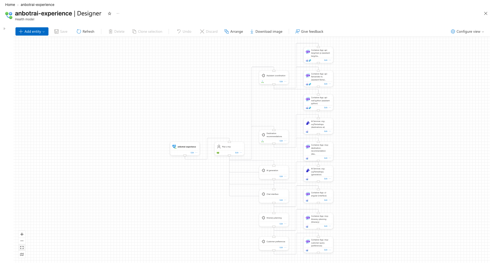
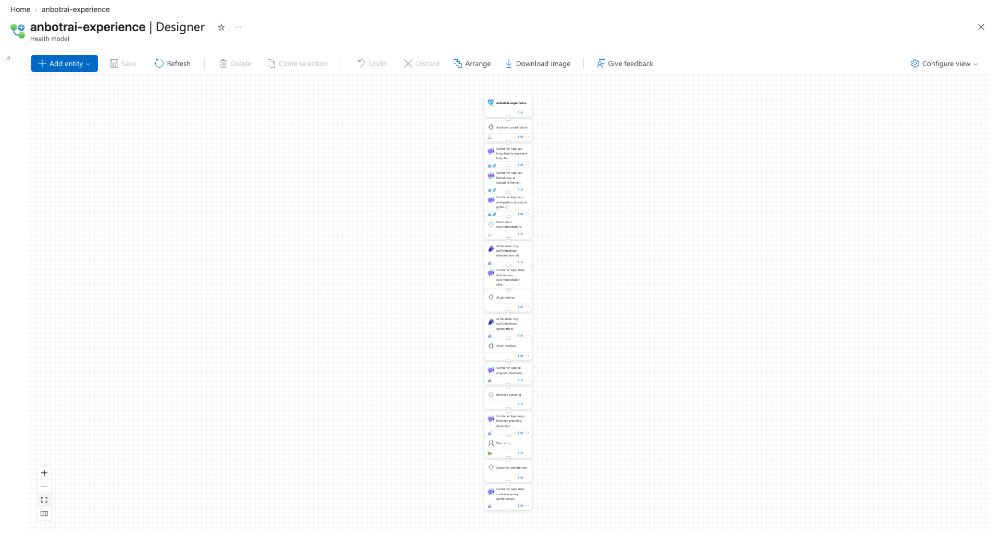

# Backup and restore around arrange

`export` is a full backup, the dry runs preview without saving, and `import` puts a hand-made layout back exactly, writing only the cards that move.

## How it is shown

- A deliberately unusual hand-made layout (left to right, which `arrange` never produces) is imported, exported as `backup.json`, then arranged over and imported back, so each screenshot is unmistakable.
- After every step the layout is exported again and compared with `jq` (`same positions: ...`), so "nothing saved" and "exactly restored" are checked, not just eyeballed.
- Running `arrange` and `import` a second time shows `0 of 17 positions change`.
- A stale file (`stale.json`) shows the unknown-name warning and that `null` clears a position; the final restore to the original layout clears 16 positions for real.

Model `anbotrai-experience`. All steps are in [`steps.sh`](steps.sh), `S=docs/arrange-showcase/scripts/showcase.sh`. Request logs dropped, long tables shortened with `...`.

## 1. Hand-made layout and backup

`prepare.json` puts the root, `plan-trip`, the services and the resources in four columns.

```text
$ az monitor health-models layout import -n anbotrai-experience --layout prepare.json --verbose
INFO: Loaded 17 entities (1 with a canvas position) and 16 relationships
INFO: 17 of 17 positions change; saving them

$ $S export anbotrai-experience backup.json      # backup.json == prepare.json
same positions: backup.json prepare.json
```


## 2. Arrange, previewed first

```text
$ $S arrange anbotrai-experience backup-arrange-dry --dry-run
Name                           X     Y
-----------------------------  ----  ---
anbotrai-experience            1250  0
assistant                      500   384
...
preferences-resource           2000  576
INFO: Part 1 of 1 is 2200 x 706 px with 0 edges through cards, 0 false links, 0 crossings, 0 label clashes
INFO: 17 of 17 positions change; dry run, nothing is saved
same positions: after-dry.json backup.json       # the model is untouched

$ $S arrange anbotrai-experience backup-arrange
INFO: 17 of 17 positions change; saving them

$ $S arrange anbotrai-experience backup-arrange-again
INFO: Loaded 17 entities (17 with a canvas position) and 16 relationships
INFO: 0 of 17 positions change; saving them      # empty table, no PUT
```



## 3. Restore the backup

```text
$ az monitor health-models layout import -n anbotrai-experience --layout backup.json --dry-run --verbose
Name                           X      Y
-----------------------------  -----  ------
anbotrai-experience            0.0    640.0
assistant                      600.0  160.0
...
preferences-resource           900.0  1280.0
INFO: 17 of 17 positions change; dry run, nothing is saved

$ az monitor health-models layout import -n anbotrai-experience --layout backup.json --verbose
INFO: 17 of 17 positions change; saving them
same positions: after-import.json backup.json

$ az monitor health-models layout import -n anbotrai-experience --layout backup.json --verbose
INFO: 0 of 17 positions change; saving them
```



## 4. Stale file: unknown names and `null`

`stale.json` clears `plan-trip`, places a `legacy-cache` entity that does not exist, and repeats the current position of `preferences-resource`.

```text
$ az monitor health-models layout import -n anbotrai-experience --layout stale.json --dry-run --verbose
Name
---------
plan-trip
WARNING: Skipping entities that are not in the health model: legacy-cache
INFO: 1 of 2 positions change; dry run, nothing is saved
```

## 5. Back to the original layout

The saved starting layout has a position only for the root; its 16 `null` rows clear the rest, and the portal stacks those cards in one column again.

```text
$ $S restore anbotrai-experience
anbotrai-experience            0.0  0.0
assistant
...
INFO: 17 of 17 positions change; saving them
same positions: after-restore.json anbotrai-experience.mangled.json
```



## Verdict

- Convincing: screenshots 01 and 03 are identical and clearly differ from 02, and each "nothing saved" or "exactly restored" claim is backed by an export diff.
- Weak: every whole-model step moves all 17 cards, so "only the cards that move" is shown by the second runs (`0 of 17`) and the `1 of 2` stale preview rather than by a partial change; the hand-made layout also routes its lines awkwardly, since the portal draws edges from the bottom to the top of cards.
