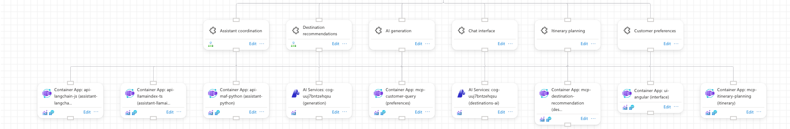
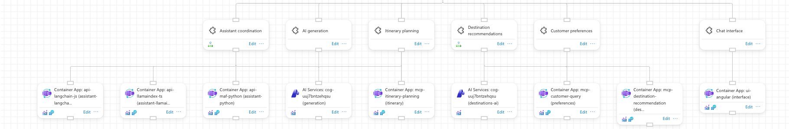

# Row order for few crossings

Arrange reorders each row (barycenter sweeps, neighbour swaps, then a local search on the portal drawing), so cross-links between services and other services' resources stop running across the whole canvas.

## How it is shown

- Three temporary `demo-*` cross-links on `anbotrai-stability`, all realistic for the travel agent app ([demo.json](demo.json)):
  - Assistant coordination → the `generation` AI Services resource (the agent calls the model)
  - Itinerary planning → the `generation` AI Services resource
  - Destination recommendations → `mcp-customer-query` (recommendations read customer preferences)
- Chosen by an offline search over 14 realistic cross-links in sets of 1 to 5, scored on the snapped layout that is actually saved. Ranked by the drop in false links and horizontal line length, keeping only sets where the sweeps lower the logged crossing count by at least 3.
- Prepared layout: the engine's own placement, but with rows in the naive depth-first input order.
- Arranged with `--engine layered`, which runs the row-order step directly. `auto` picks `layered` too (score 108 vs 437 for `tree`). Designer only: the Graph view draws the same lines.

## Commands

```bash
S=docs/arrange-showcase/scripts/showcase.sh
F=docs/arrange-showcase/features/crossings
$S lock anbotrai-stability feature-crossings
$F/topology.sh add                                  # PUT the demo-* relationships in demo.json
$S import anbotrai-stability $F/prepared.json
$S arrange anbotrai-stability crossings-layered --engine layered
$S arrange anbotrai-stability crossings-auto --dry-run
$F/topology.sh remove && $F/topology.sh names | diff - $F/names.before.json
$S restore anbotrai-stability
$S unlock anbotrai-stability feature-crossings
```

## Screenshots

- Prepared, input order: [01-prepared-designer.png](01-prepared-designer.png), zoomed: [01-prepared-zoom.png](01-prepared-zoom.png)
  - All 19 service-to-resource lines merge into one bar across the whole resource row. Assistant's line reaches the generation resource, and Itinerary planning's line reaches its own resource on the far right.
- Arranged: [02-arranged-designer.png](02-arranged-designer.png), zoomed: [02-arranged-zoom.png](02-arranged-zoom.png)
  - Services `assistant, generation, itinerary | destinations, preferences | interface`. The resource row splits into three separate line groups with gaps between them: the assistant, generation and itinerary group; the destinations and preferences group; and Chat interface on its own straight line.




## Proof

From [`logs/anbotrai-stability.crossings-layered.log`](../../logs/anbotrai-stability.crossings-layered.log):

```
Row order: 6 crossings to start with, 0 at best (after 3 of 12 sweeps)
Local search kept 1 of 26 swaps (limit 300), score 109 -> 108 (lower is better)
Part 1 of 1 is 2200 x 706 px with 0 edges through cards, 10 false links, 0 crossings, 0 label clashes
```

Counted on the saved layouts ([prepared.json](prepared.json), [arranged.json](arranged.json)) with `crossings()`, `describe()` and `cost()` from `layout.py`:

| | row crossings | horizontal line length | false links | `cost` |
|---|---|---|---|---|
| prepared | 11 | 7500 px | 42 | 443 |
| arranged | 1 | 4500 px | 10 | 108 |

- 11 vs 6: the log's start count is taken after the first neighbour swaps (`transpose`).
- 0 vs 1: the local search swap accepts one row crossing for a better portal drawing.

## Finding: snapping can undo the local search

- `arrange()` snaps every card to the 125 px grid (`normalize`) after the engine has scored the layout.
- An earlier four-link set (Assistant → itinerary and preferences MCP servers, Chat interface → `api-maf-python`, Destination recommendations → `generation`) logged `Local search kept 1 ..., score 423 -> 186` and `Auto: layered has ... 17 false links`. The snapped, saved layout had 41 false links and score 425, so almost the whole gain was lost.
- The set above is not affected (10 false links before and after snapping).

## Verdict

- Showcases the feature well now: the screenshots show one merged bar turning into three separate, short line groups, and the log, false links (42 → 10) and line length (7500 → 4500 px) back that up.
- Weak: the local search's own share is tiny here (score 109 → 108). The portal still merges lines within a group (10 false links), so the drawing does not show individual crossings.
