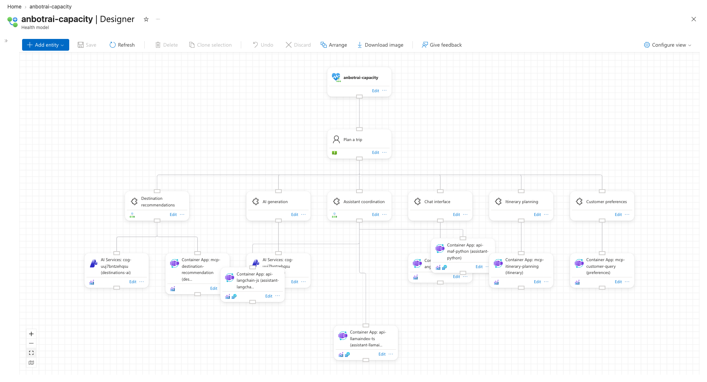
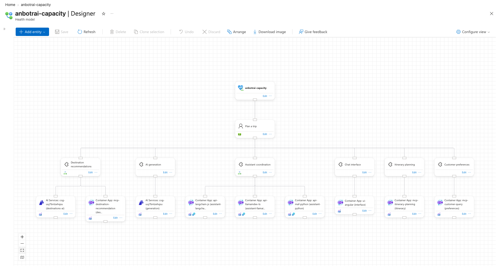
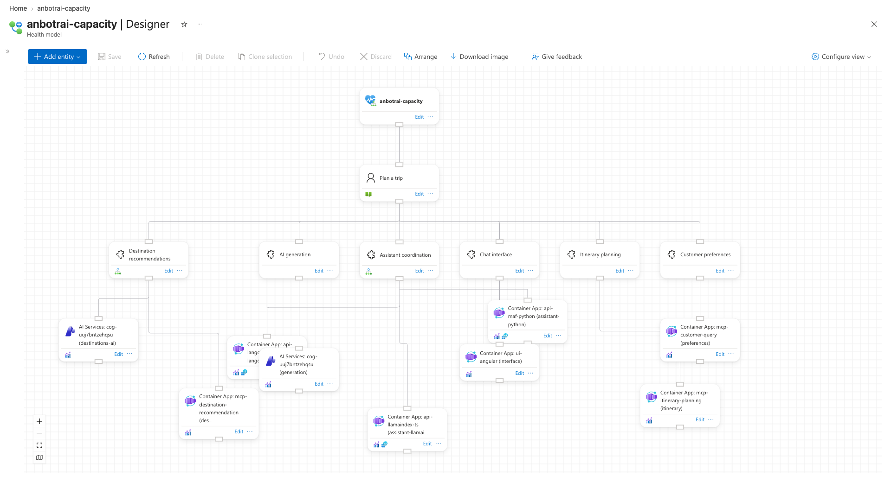
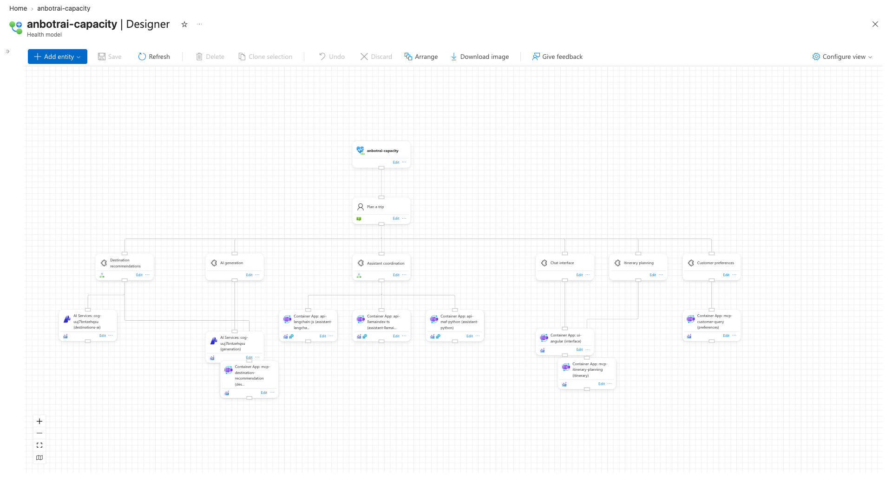
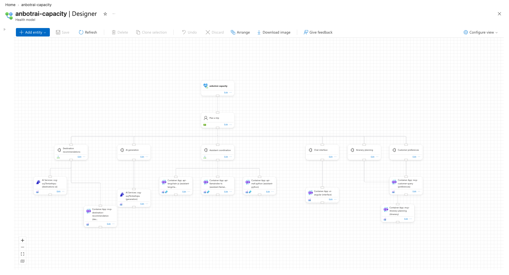
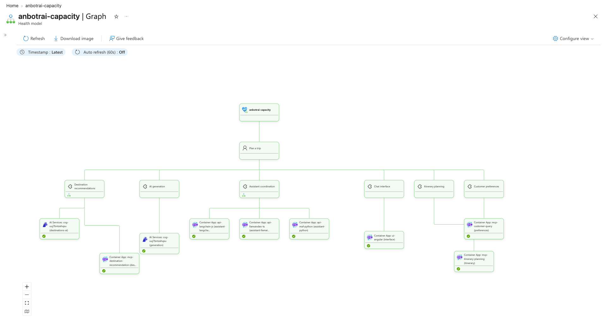

# Arrange one subtree

`arrange --entity-name assistant` tidies only `assistant` and its three resources, keeps `assistant` where it is, and slides the cards beside them in those rows just far enough that nothing overlaps.

## How it is shown

- `prepare.json` is a tidy tree with `assistant` in the middle of the service row, but its three resources scrambled: one overlaps `generation-resource`, one overlaps `interface-resource`, one hangs a row too low. The neighbours sit one column apart, so a tidy subtree (three cards wide) does not fit.
- Arranging the subtree lines up the three resources under `assistant`; the cards left of `assistant` in the service and resource rows slide one column left, the cards right of it one column right.
- `anbotrai-capacity` and `plan-trip` are above the subtree's rows and do not move, and `assistant` keeps (750, 384).

## Commands

```bash
S=docs/arrange-showcase/scripts/showcase.sh
$S lock anbotrai-capacity feature-subtree
$S import anbotrai-capacity docs/arrange-showcase/features/entity-subtree/prepare.json
$S arrange anbotrai-capacity subtree-dry-run --entity-name assistant --dry-run
$S arrange anbotrai-capacity subtree --entity-name assistant
$S restore anbotrai-capacity
$S unlock anbotrai-capacity feature-subtree
```

## Screenshots

- Prepared: 
- After `--entity-name assistant`: 

## Proof

- Decision log ([`anbotrai-capacity.subtree.log`](../../logs/anbotrai-capacity.subtree.log)):
  - `Arranging only 'assistant' and the entities below it; 'assistant' keeps its position`
  - `Arranging 4 entities and 3 relationships with engine 'auto' as 1 part(s)`
  - `'assistant' stays at (750, 384); 6 cards beside it slid 250 px right, 5 slid 250 px left to clear the subtree`
  - `14 of 15 positions change; saving them` (15 = 4 subtree cards + 11 cards in its rows; the one unchanged is `assistant`)
- [`dry-run.txt`](dry-run.txt) lists every move before saving: the 3 resources to x 500, 750, 1000 at y 576; `interface`, `itinerary`, `preferences` and their resources +250; `destinations`, `generation` and their resources -250. It matched the offline `arrange_below` result exactly.
- Export after arrange compared with `prepare.json`: only `anbotrai-capacity`, `plan-trip` and `assistant` kept identical positions.
- `describe` on the whole model: prepared 2 edges through cards, 2 crossings; after 0 edges through cards, 0 crossings.

## Verdict

- Shows the feature well: the before/after pair makes the scrambled subtree, the fixed parent and the sideways slide obvious, and the log line gives the exact counts.
- Weak: Fit View rescales each screenshot, so "assistant did not move" is visible only relative to `plan-trip` above it; and since every service shares the band, 11 of 13 other cards slide, so "everything else stays" is shown by just the two cards above.

## Cards just outside the subtree's rows

A sliding card used to stop at the subtree's rows: a card just below them stayed where it was, so a card sliding past could land on it. Now that card slides along, and so does any card it would run into.

- [`off-row-prepare.json`](off-row-prepare.json): the prepared canvas above, plus:
  - `assistant` at (750.4, 384.6)
  - `interface-resource` and `generation-resource` lowered to y 640 and 650, still inside the subtree's rows
  - `itinerary-resource` at (1450, 740) and `destinations-mcp-resource` at (300, 750), just below those rows
- [`off-row-old-result.json`](off-row-old-result.json): what the old `arrange_below` (commit 072be37) returns for that canvas, computed offline and imported for the screenshot. Two overlaps: `interface-resource` slid onto `itinerary-resource`, `generation-resource` onto `destinations-mcp-resource`.
- [`off-row-new-result.json`](off-row-new-result.json): the new code offline. The live `arrange --entity-name assistant` exported exactly these positions.

| Prepared | Old code: 2 overlaps | New code: 0 overlaps |
|---|---|---|
|  |  |  |

Graph view after the new code: 

- Decision log ([`anbotrai-capacity.off-row.log`](../../logs/anbotrai-capacity.off-row.log)): `'assistant' stays at (750.4, 384.6); 6 cards beside it slid 375 px right, 5 slid 250 px left to clear the subtree`. The old code moved 5 and 4: the two cards below the rows stayed put.
- `describe` on the whole model:
  - prepared: 3 edges through cards, 2 crossings
  - old code: 2 edges through cards, 1 crossing
  - new code: 1 edge through a card, 0 crossings

  The remaining edge is `itinerary` to its off-row resource, which already ran through `preferences-resource` in the prepared canvas.
- Restored afterwards; the export matched `layouts/anbotrai-capacity.mangled.json`.
