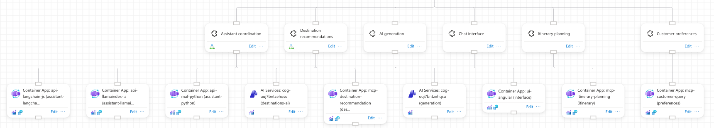
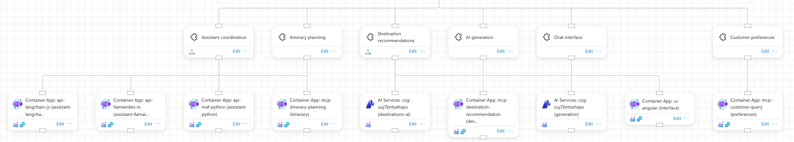
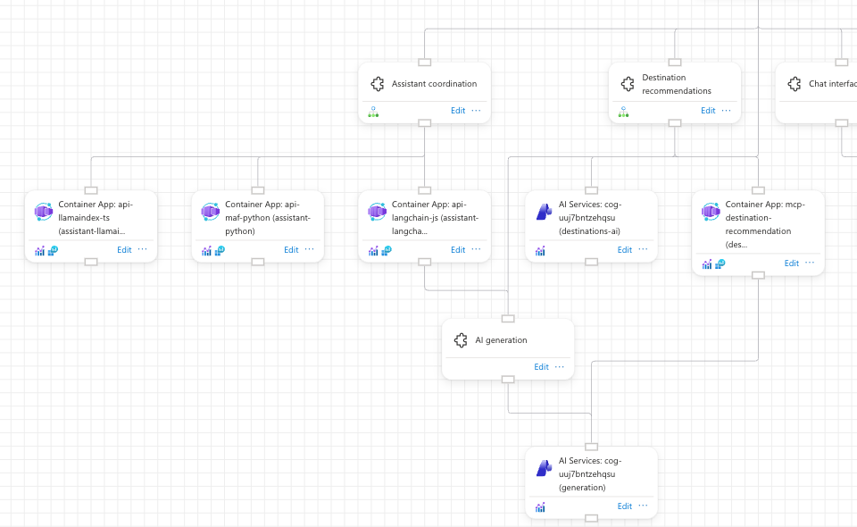
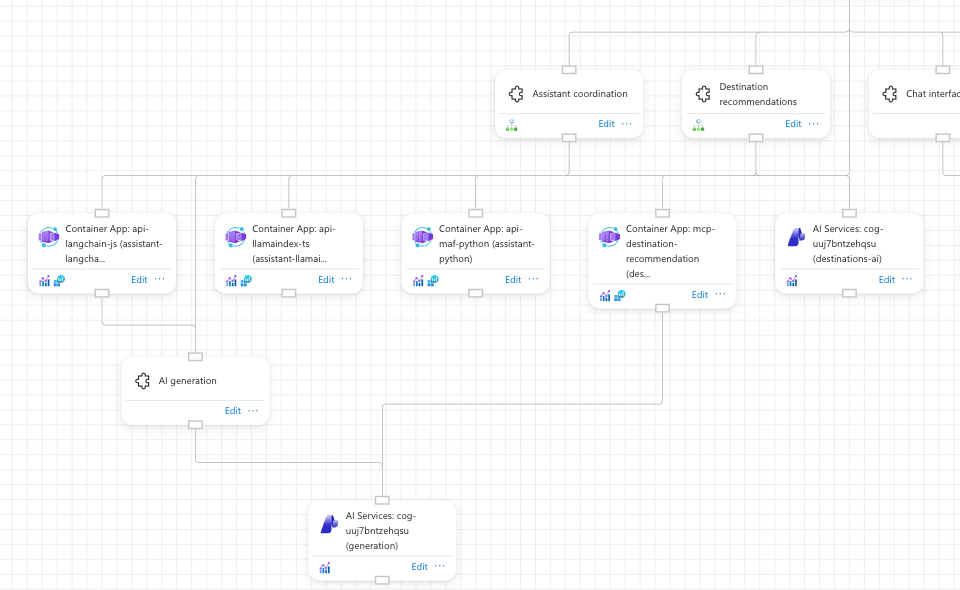

# Cards with several parents

When a card has two parents, `tree` keeps every subtree in its own columns and `layered` moves cards so the lines stay short. `auto` draws both, scores them the way the portal renders them and keeps the better one, and the two variants below show it keeping each engine once.

## How it is shown

- Model `anbotrai-stability`, one temporary topology at a time ([topology.sh](topology.sh)):
  - **a**: `assistant` also watches the itinerary MCP server (`demo-assistant-itinerary`: `assistant` -> `itinerary-resource`).
  - **b**: the LangChain assistant uses AI generation, and the destinations MCP server calls the generation model (`demo-langchain-generation`: `assistant-langchain-resource` -> `generation`, `demo-destinations-mcp-generation`: `destinations-mcp-resource` -> `generation-resource`).
- **a**: `tree` leaves `Itinerary planning` in its own column (5th service), so the `assistant` line runs past three unrelated resources. `layered` moves the whole itinerary subtree next to `Assistant coordination`. `auto` keeps `layered`.
- **b**: `AI generation` and its model drop below the resources. `tree` hangs both under their shared ancestor, between the two parents, with their own short lines. `layered` pushes `AI generation` to the far left, so its line from `Plan a trip` runs along the assistant's resource bar. `auto` keeps `tree`.
- Each `auto` screenshot is byte-identical to the engine it kept.

## Commands

```bash
S=docs/arrange-showcase/scripts/showcase.sh
F=docs/arrange-showcase/features/shared-children
$F/topology.sh add a            # then b: remove a, add b, same three runs
$S arrange anbotrai-stability shared-a-tree --engine tree
$S restore anbotrai-stability
$S arrange anbotrai-stability shared-a-layered --engine layered
$S restore anbotrai-stability
$S arrange anbotrai-stability shared-a-auto
$S restore anbotrai-stability
$F/topology.sh remove a
```

## Screenshots

- Prepared (stacked by the portal): [01-prepared-designer.png](01-prepared-designer.png)
- a, `tree`: [02-a-tree-designer.png](02-a-tree-designer.png), crop [02b-a-tree-lines.png](02b-a-tree-lines.png)
- a, `layered`: [03-a-layered-designer.png](03-a-layered-designer.png), crop [03b-a-layered-lines.png](03b-a-layered-lines.png)
- a, `auto` (same as layered): [04-a-auto-designer.png](04-a-auto-designer.png)
- b, `tree`: [05-b-tree-designer.png](05-b-tree-designer.png), crop [05b-b-tree-generation.png](05b-b-tree-generation.png)
- b, `layered`: [06-b-layered-designer.png](06-b-layered-designer.png), crop [06b-b-layered-generation.png](06b-b-layered-generation.png)
- b, `auto` (same as tree): [07-b-auto-designer.png](07-b-auto-designer.png)

Variant a, tree then layered: the itinerary subtree moves from 5th to 2nd column.




Variant b, tree then layered: `AI generation` sits between its parents in tree and far left in layered.




## Proof

Logs in `docs/arrange-showcase/logs/anbotrai-stability.shared-{a,b}-{tree,layered,auto}.log`.

- a, tree: `Tree: 1 cards with several parents hang under the deepest ancestor their parents share`, `... 31 false links, 0 crossings`
- a, layered: `... 0 edges through cards, 11 false links, 0 crossings`
- a, auto:
  - `Auto: layered has 0 edges through cards, 3 false links, 0 crossings, 0 label clashes, score 37`
  - `Auto: tree has 0 edges through cards, 31 false links, 0 crossings, 0 label clashes, score 322`
  - `Auto: keeping layered, the lower score`
- b, tree: `Tree: 2 cards with several parents hang under the deepest ancestor their parents share`, `... 3 false links, 0 crossings`
- b, layered: `... 0 edges through cards, 12 false links, 0 crossings`
- b, auto:
  - `Auto: layered has 0 edges through cards, 12 false links, 0 crossings, 0 label clashes, score 129`
  - `Auto: tree has 0 edges through cards, 3 false links, 0 crossings, 0 label clashes, score 35`
  - `Auto: keeping tree, the lower score`
- After each `topology.sh remove`, the entity and relationship names (17 and 16) and the exported layout matched the saved state.

## Verdict

- Both outcomes of `auto` are shown with their log lines, and in each variant the two engines differ at a glance: a subtree changes columns in a, and a shared card changes sides in b.
- Weak: `auto` scores positions before they snap to the grid. In a, it logs layered at 3 false links, but the saved layout has 11. A first try at b (`assistant-python-resource` calling three services) scored tree better offline after snapping, but live `auto` kept layered because of this.
