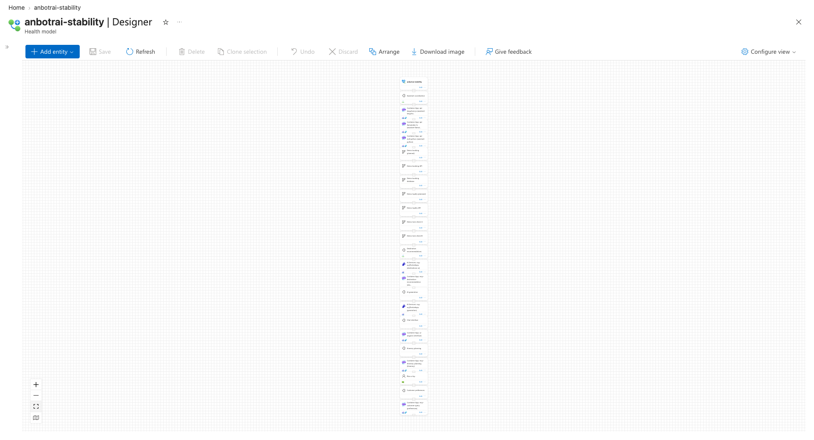
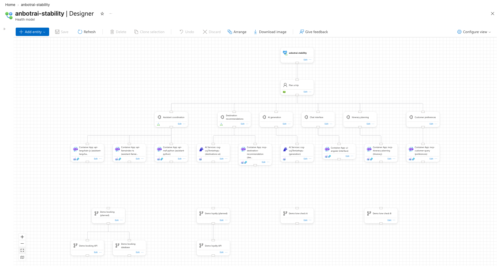

# Shelve unconnected parts

`arrange` lays out each unconnected part of a model on its own, largest first, and shelves the parts left to right with an empty column between them, opening a new shelf below when that fits a 16:9 screen better.

## How it is shown

- On `anbotrai-stability`, [`topology.sh add`](topology.sh) adds 7 temporary `demo-*` entities as 4 extra parts: a planned service with two resources (`demo-booking`, 3 cards), a service with one resource (`demo-loyalty`, 2 cards) and two lone cards (`demo-orphan-a`, `demo-orphan-b`). Only the model root has a position, so the portal stacks all 24 cards in one column.
- Arranging keeps the 17-card trip tree as part 1 on top. Part 2 (booking) opens a second shelf below it; loyalty and the two lone cards go beside it, each one empty column apart.
- The demo parts were designed offline with `arrange` first; the live run made the same decisions and positions.

## Commands

```bash
S=docs/arrange-showcase/scripts/showcase.sh
T=docs/arrange-showcase/features/shelves/topology.sh
$S lock anbotrai-stability feature-shelves
$T snapshot
$T add
$S arrange anbotrai-stability shelves-arrange
$T remove
$T verify
$S restore anbotrai-stability
$S unlock anbotrai-stability feature-shelves
```

## Screenshots

- Prepared (24 cards stacked): 
- Arranged (trip tree on shelf 1, four demo parts on shelf 2): 

## Proof

- Decision log ([`anbotrai-stability.shelves-arrange.log`](../../logs/anbotrai-stability.shelves-arrange.log)):
  - `Arranging 24 entities and 19 relationships with engine 'auto' as 5 part(s)`
  - `Part 1 of 5 is 2200 x 706 px ...`, `Part 2 of 5 is 450 x 322 px ...`, `Part 3 of 5 is 200 x 322 px ...`
  - `Part 2 opens a new shelf below the others: that fits a 16:9 screen better`
  - `Part 3 goes beside the previous one on the current shelf`
- The `fit` zoom behind the decisions (`min(16 / w, 9 / h)`, bigger wins):
  - Part 2: beside gives 2950 x 706, zoom 0.0054; new shelf gives 2200 x 1282, zoom 0.0070, so a new shelf.
  - Part 3: beside keeps 2200 x 1282, zoom 0.0070; another shelf would give 2200 x 1858, zoom 0.0048, so beside.
- Exported positions: shelf 2 starts at y 960 (two rows below the tree's last row at 576). Part left edges at x 0, 750, 1250, 1750: each previous part's right edge plus 300 px (one 200 px card column and two 50 px gaps).
- After `remove`: entity and relationship names match the snapshot (17 and 16); the exported layout matches `layouts/anbotrai-stability.mangled.json`.

## Verdict

- Shows the feature well: the arranged screenshot reads at a glance as one tall tree on top and a row of smaller parts below, largest first, with even empty columns between them, and the log names both decisions.
- Weak: the two lone cards' decisions are logged only at debug level (one-card parts), so `--verbose` shows decisions for parts 2 and 3 only; and only one new shelf opens, since the small parts all fit under the 2200 px tree.
